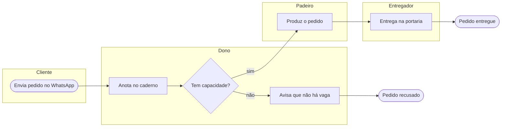
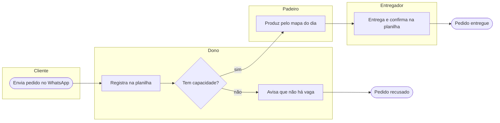

# Example: process-modeler

Input: "Hoje o pedido chega por WhatsApp, o dono anota num caderno, o padeiro produz e o entregador leva."

## Process Modeler: Pedido de assinatura
**Hoje o caderno é o ponto de falha; no to-be o pedido nasce numa planilha única.**

### Scope and actors
Gatilho: cliente envia pedido. Fins: pedido entregue, ou pedido recusado. Atores: Cliente, Dono, Padeiro, Entregador.

### As-is (Mermaid)

### To-be (Mermaid)

### Delta
- Caderno vira planilha compartilhada: o padeiro lê o mapa do dia sem perguntar ao dono.
- Entrega passa a ser confirmada: remove o "entregou?" por mensagem.
- Não desenhado: mensagens entre pools e eventos de borda (limite do Mermaid, não do processo).
